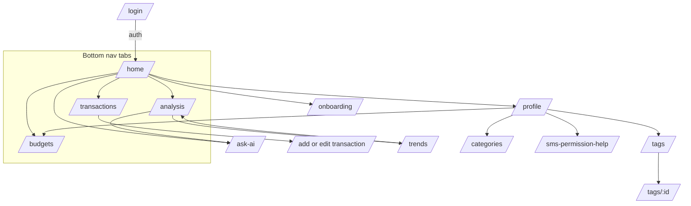

# Expense Tracker — Feature & UI Reference

A complete, element-by-element reference for every screen in the app: what each UI element shows, where it renders (file:line), how its value is computed, how you interact with it, edge/empty states, and known inconsistencies.

This is a mobile-first Angular (standalone components + signals) PWA / Capacitor Android app backed by Firebase (Auth + Firestore + Cloud Functions). All data is scoped to a "home" (household); most amounts respect a global privacy mask.

---

## Table of contents

- [1. App map & navigation](#1-app-map--navigation)
- [2. Core data model](#2-core-data-model)
- [3. Global / shared UI](#3-global--shared-ui)
- [4. Home / Dashboard](#4-home--dashboard-home)
- [5. Onboarding](#5-onboarding-onboarding)
- [6. Transactions list](#6-transactions-list-transactions)
- [7. Add / Edit transaction](#7-add--edit-transaction-add-transaction--edit-transactionid)
- [8. Categories](#8-categories-categories)
- [9. Tags & Tag detail](#9-tags--tag-detail-tags--tagsid)
- [10. Budgets](#10-budgets-budgets)
- [11. Analysis](#11-analysis-analysis)
- [12. Trends](#12-trends-trends)
- [13. Ask AI](#13-ask-ai-ask-ai)
- [14. Login](#14-login-login)
- [15. Profile](#15-profile-profile)
- [16. SMS permission help](#16-sms-permission-help-sms-permission-help)
- [17. Known bugs & inconsistencies](#17-known-bugs--inconsistencies)

---

## 1. App map & navigation

Routes are defined in [src/app/app.routes.ts](src/app/app.routes.ts); every route except `/login` is protected by `authGuard`.

- `/` -> redirects to `/home`
- `/home` -> Home / Dashboard
- `/onboarding` -> Create/Join a home
- `/transactions` (alias `/dashboard`) -> Transactions ledger
- `/add-transaction`, `/edit-transaction/:id` -> same component (add vs edit)
- `/categories` -> Category manager
- `/tags`, `/tags/:id` -> Tags list, Tag detail
- `/budgets` -> Monthly budgets
- `/analysis` -> Category breakdown / distribution
- `/trends` -> Multi-month spending trends
- `/ask-ai` -> AI chat over your transactions
- `/profile` -> Profile & settings
- `/sms-permission-help` -> Android SMS setup help
- `/login` -> Auth (unguarded)

The **bottom navigation** (Home, Transactions, [+] FAB, Budgets, Analytics) is shown on most screens and hidden on `/login`, `/onboarding`, `/add-transaction`, `/edit-transaction/*`, and `/sms-permission-help` (`bottom-nav.component.ts` visibility computed).

---

## 2. Core data model

Defined in [src/app/core/models/models.ts](src/app/core/models/models.ts) and service files. All collections are Firestore, scoped by `homeId`.

### Transaction (`models.ts:3-14`)
- `id`, `amount` (number), `categoryId`, `accountId?` (always `'default'` today), `date` (Date), `note?`, `type` (`'income' | 'expense'`), `userId?`, `userEmail?`, `tagIds?` (string[]).

### Category (`models.ts:25-31`)
- `id`, `name`, `icon` (Material icon name), `color` (hex), `type` (`'income' | 'expense'`).
- Built-in defaults merged with home-scoped custom categories in `category.service.ts`.

### Tag (`models.ts:16-23`)
- `id`, `name`, `color?`, `note?`, `createdBy?`, `createdAt?`.

### Budget / CategoryRecurringBudget (`models.ts:40-55`)
- Recurring monthly cap per category, stored at `homes/{homeId}/categoryBudgets/{categoryId}` as `{ categoryId, amount, homeId, updatedAt }`. Legacy per-month docs are ignored on load.

### Home / household (`home.service.ts:7-14`)
- `id`, `name`, `displayId` (6-char invite code), `ownerId`, `memberIds[]`, `createdAt`.

### User (two representations)
- **Firebase Auth user** (`auth.service.ts`): `displayName`, `email`, `photoURL`, `uid` — used for profile display.
- **Firestore `users/{uid}`**: `{ id, email, name, photoURL, createdAt, homeId }` — used for member names/attribution.
- Note: profile header uses Auth `displayName`; member/person lists use Firestore `name` — these can diverge.

### Notification (`models.ts:57-67`)
- `id`, `type` (`transaction_added | transaction_updated | transaction_deleted`), `message`, `transactionId?`, `homeId?`, `createdBy`, `createdByName`, `createdAt`, `readBy[]`.

---

## 3. Global / shared UI

### App shell — [src/app/app.component.html](src/app/app.component.html)
- `<router-outlet>` (active screen), `<app-bottom-nav>` (conditional), `<app-changelog-dialog>` (global "What's new" modal).
- Native lifecycle (`app.component.ts`): hides splash, syncs Android status bar to theme, initializes SMS ingest, handles hardware back button and deep links, resyncs Firestore on resume.
- Headers are per-page (no global header).

### Bottom navigation — `bottom-nav.component.ts`
- Tabs: Home (`/home`), Transactions (`/transactions`), center **FAB** [+] (`/add-transaction`), Budgets (`/budgets`), Analytics (`/analysis`).
- Active tab highlighted via `routerLinkActive`. Fixed to bottom, z-index 50.
- Hidden on login/onboarding/add/edit/sms-help routes.

### Notification bell — `notification-bell.component.*` (in Home & Transactions headers)
- Amber bell with unread badge (`unreadCount()`, capped at `9+`); excludes notifications you created and ones you've read.
- Dropdown: "Mark all as read", push-permission banners, notification rows (icon, message, relative time, unread dot), "Load more" pagination (page size 10).
- Clicking a row marks it read and navigates to `/edit-transaction/:id` (unless the transaction was deleted).
- Empty state: "No notifications yet".

### Theme / dark mode — `theme.service.ts`
- Preference `system | light | dark` stored in `localStorage['expense-tracker.theme']`.
- **Profile** exposes an explicit 3-way segmented control; **Home header** exposes a single icon that *cycles* system -> light -> dark.
- Applies `dark` class on `<html>` and syncs meta theme-color / Android status bar.

### Privacy mode — `privacy-mode.service.ts`
- Toggles `hideAmounts` (persisted in `localStorage`). When on, every amount rendered through the `maskCurrency` pipe shows `••••`.
- Toggle available on Home header (icon) and Profile (labeled row + switch).

### maskCurrency pipe — `mask-currency.pipe.ts`
- Impure pipe (`pure:false`) so it re-renders when privacy toggles. Default currency INR (`en-IN`), e.g. `₹1,250.00`. Returns `••••` when hidden, `''` for null.

### Changelog "What's new" dialog — `changelog-dialog.component.*`
- Global modal, opened from Profile ("What's new") and auto-shown once on Transactions when unseen (per-UID `localStorage` key).
- Lists entries grouped by date; "Got it" dismisses and marks seen.

### Feedback / toasts
- There is **no snackbar/toast component**. Feedback uses inline text (export, forms), the login error banner, and browser `alert()` (invite copied, leave-home failure, save failure, SMS notice).

---

## 4. Home / Dashboard (`/home`)

Files: [home.component.html](src/app/features/home/home.component.html), [home.component.ts](src/app/features/home/home.component.ts). Metrics come from [insights.service.ts](src/app/core/services/insights.service.ts).

Hydration gate: content hidden behind "Loading insights..." until home init + transactions load (`home.component.ts:34-36`). If initialized with no home, redirects to `/onboarding`.

### Header (`home.component.html:3-26`)
- **Greeting** (`:5`): "Good morning/afternoon/evening" from `greeting()` (`home.component.ts:38-44`). Bug: computes the user's `name` but never appends it, so it is never personalized.
- **Household subtitle** (`:6`): `currentHome()?.name` or fallback "Your household".
- **Theme toggle** (`:9-14`): `light_mode`/`dark_mode`; cycles preference.
- **Privacy toggle** (`:15-20`): `visibility`/`visibility_off`; toggles amount masking.
- **Notification bell** (`:21`): see global section.
- **Profile link** (`:22-24`): generic `person` icon -> `/profile` (no photo avatar here).

### Net Cash Flow hero (`home.component.html:35-57`)
- Label "Net Cash Flow · This Month".
- **Net amount** = `income - expense` for the current calendar month (`financialHealth`, `insights.service.ts:114-134`).
- **Delta subtitle** e.g. "+15% vs last month" via `periodOverPeriodDelta(thisMonthNet, lastMonthNet)`; hidden when prior month net is 0.
- **Income row** (emerald) / **Expense row** (rose) — month sums. Note: income uses a down-arrow and expense an up-arrow (unconventional).

### Burn Rate card (`home.component.html:62-102`)
- **Daily burn rate** = `spentMtd / daysElapsed` (day-of-month).
- **Sparkline SVG**: cumulative daily spend (solid) + dashed forecast to month-end + "today" dot; hidden when no MTD spend.
- **Narrative**: "No spending recorded…", "…you'll save this month.", or "…spending may exceed income." based on `projectedSavings = income - monthEndForecast`.
- **Forecast line** = `dailyBurnRate × totalDaysInMonth`.

### Budget Pacing card (`home.component.html:105-132`)
- When budgets exist: "Day X of Y: N% budget used", progress bar, and status label ("On track" / "Slightly ahead" / "Pacing ahead of schedule").
- Status from pacing ratio `(spent/budget) / (daysElapsed/totalDays)`: `>1.1` warning (red), `<=1.0` on-track (green), else ahead (orange).
- Empty state: "Set budgets to track pacing." + "Add budgets ->" link.

### Categories at risk (`home.component.html:136-150`)
- Visible only when there are category warnings. Top 3 categories by pacing ratio > 1.0, each showing "₹spent / ₹budget" for the current month. Display-only.

### Smart Insights (`home.component.html:153-168`)
- Up to 6 heuristic cards (icon + title + narrative), not clickable. Generated in `insights.service.ts:210-348`:
  - **Spending Spike** — this week vs last week, >= 15%.
  - **Weekend Spending** — Fri+Sat share of month >= 40% (narrative says "discretionary" but counts all expenses).
  - **Top Burner** — highest-spend category this month.
  - **Rising Category** — a category's last-14-days vs prior-14-days, best rise >= 20% (can explode from a near-zero base).
  - **Household Split** — top member's share of this month's spending (may show a raw user ID if the member name isn't loaded).

### Recurring Bills (`home.component.html:171-189`)
- Up to 4 detected recurring expenses over the last ~6 months (`detectRecurringExpenses`, `recurring-expenses.ts:59-142`): grouped by category+normalized note, >= 3 occurrences, cadence + amount-variance thresholds.
- Each card shows label, "cadence · category", the **average** amount, and "Last: MMM d" (the latest payment date). Note: the amount is the average across occurrences, not the last payment — so it can differ from the most recent transaction of the same name.

### Ask AI banner (`home.component.html:192-199`)
- Static gradient card ("Why did my grocery spend increase?") -> `/ask-ai`.

### Recent Activity (`home.component.html:202-232`)
- Latest 5 transactions across all time (not month-scoped), sorted by date desc. Each row: category icon/name, date+time, signed amount. Rows are not tappable. Empty: "No transactions yet".

---

## 5. Onboarding (`/onboarding`)

File: [home-onboarding.component.ts](src/app/features/home/home-onboarding.component.ts) (inline template). No bottom nav.

- **Title/subtitle**: "Welcome to Expense Tracker" / "…create a new home or join an existing one."
- **Sign out** button -> `authService.logout()`.
- **Tab toggle**: "Create New Home" (default) / "Join Existing Home".
- **Create form**: Home Name input + "Create Home" button (disabled until name entered; shows "Creating…"). Success -> `/home`. Bug: create errors are set but there is no error banner on the Create tab.
- **Join form**: uppercase invite-code input + helper text + error banner + "Join Home" button. Calls `homeService.joinHome(code)` (Cloud Function). Success -> `/home`.

---

## 6. Transactions list (`/transactions`)

Files: [dashboard.component.html](src/app/features/dashboard/dashboard.component.html), [dashboard.component.ts](src/app/features/dashboard/dashboard.component.ts). Data from `transaction.service.ts` (period filter, totals) + category/tag services.

### Header (`:3-21`)
- Title "Transactions" / subtitle "Your spending ledger".
- **PWA install** button (only when the browser fired `beforeinstallprompt`; never on native).
- Notification bell + profile link.

### Balance card (`:25-45`)
- **Total Balance** = income − expense for the **current period filter** (not all-time; search does not affect it).
- Income and Expense sub-totals for the period.

### Date navigator (`:50-78`)
- Prev/next chevrons (Daily: ±1 day; Monthly: ±1 month).
- Clickable period label opens a native date/month picker.
- An "All Time" label branch exists but is dead code (filter is only daily/monthly).

### Filter tabs (`:81-94`)
- **Daily** / **Monthly** segmented control. Switching to Daily resets to today; leaving Monthly collapses the budget-alerts banner.

### Search (`:97-113`)
- Placeholder "Search category, note, tag…"; clear button; live match count "N matches in this period".
- Matches (case-insensitive substring) against category name, note, type, userEmail, amount (raw + 2dp), and tag names. Filters the list only (not the balance/totals).

### Budget heads-up banner (monthly only) (`:115-165`)
- Shown when monthly budget alerts exist. Collapsed summary ("N categories are over budget this month.") with expand/collapse.
- Expanded: "View budgets" link + per-category rows (name, "Over"/"Near limit" badge, progress bar, "₹spent / ₹budget"). "Over" when spent > budget, "Near limit" when spent >= 90%. Sorted over-first.

### Transaction list (`:168-237`)
- Loading: "Loading transactions…". Empty: "No transactions match …" (search) or "No transactions found for this period".
- **Date group headers** (e.g. "Sep 7, Sunday") with a right-aligned **net** for that day (income − expense; unlabeled, easy to misread as total spend).
- **Transaction row**: category icon circle, category name, time + optional note, optional colored tag chips (tapping a chip -> `/tags/:id`), signed amount (green income / red expense), and a small lock icon on transactions you don't own. Tapping a row -> `/edit-transaction/:id`.

---

## 7. Add / Edit transaction (`/add-transaction` & `/edit-transaction/:id`)

File: [add-transaction.component.html](src/app/features/add-transaction/add-transaction.component.html) + `.ts`. Same component for add and edit; capabilities depend on `isEdit()` and `isOwner()`.

- **Header**: back button; title "Add Transaction" / "Edit Transaction" / "View Transaction" (non-owner); red delete button only when editing your own transaction (confirm dialog).
- **Non-owner banner**: explains the transaction is read-only; form disabled, no save/delete.
- **Loading**: "Loading transaction…" while fetching for edit; missing id redirects to `/transactions`.
- **Type toggle**: Income (green) / Expense (red), default expense. Bug: switching type does not reset the selected category, so a now-hidden category can remain selected.
- **Amount**: number, `₹` prefix, required, min 0.01.
- **Category picker**: 4-column icon grid filtered to the current type; required.
- **Budget draft alerts**: for expenses on a budgeted category, warns "Approaching monthly budget" (>= 90%) or "Over monthly budget" (projected spend incl. this draft exceeds the cap). Excludes the current transaction when editing. (These are recurring-budget warnings, not recurring-transaction scheduling.)
- **Date / Time / Note**: date + time default to now; note optional.
- **Tags (optional)**: toggle existing tags; "+ New tag" inline creator (name + color validation, duplicate check).
- **Save**: "Save Transaction" / "Update Transaction" (disabled until valid; shows "Saving…"). Persists via `transaction.service.ts` with `userId`, `homeId`, `accountId:'default'`.
- **SMS prefill**: no on-screen SMS UI. An Android SMS receiver deep-links into this screen with `smsPrefill=1&type=&amount=` and prefills amount/type only (no category/date/note). Prefill does not run on the edit route.

---

## 8. Categories (`/categories`)

Files: [category-list.component.html](src/app/features/category-manager/category-list/category-list.component.html) + `.ts`. Service: `category.service.ts`.

- **Header**: back -> `/transactions`, title "Categories".
- **Add / Edit form**: heading toggles "Add Custom Category" / "Edit Custom Category". If no home, shows a warning and hides the form. Fields: name (required, max 40), type (Expense/Income), color picker (default `#3B82F6`), icon grid (22 Material icons, labels auto-formatted). Inline error/success messages. Submit "Add Category" / "Update" / "Saving…"; Cancel resets.
- **Income list** and **Expense list**: rows show color circle + icon + name. Default categories cannot be edited/deleted (edit/delete icons hidden for them); custom categories have edit (scrolls to form) + delete (confirm) actions.
- Persistence: custom categories at `homes/{homeId}/categories/{id}`; duplicate name per type is rejected.
- Notes: default category "gift" is lowercase; lists have no empty state (defaults always present).

---

## 9. Tags & Tag detail (`/tags` & `/tags/:id`)

Files: [tag-list.component.html](src/app/features/tags/tag-list.component.html), [tag-detail.component.html](src/app/features/tags/tag-detail.component.html) + `.ts`.

### Tags list
- Header: back -> `/transactions`, title "Tags & Groups" (no separate "groups" feature exists).
- **Add / Edit tag form**: name (required, max 40), color, optional note; inline error/success; Add/Update/Saving + Cancel. Requires a home.
- **Your tags**: each row is a link to `/tags/:id` showing a `sell` avatar (color customizable, icon fixed), tag name, and a summary "N transactions · ₹X spent" (count includes income; "spent" is expense-only, shown only when > 0). Edit/Delete buttons stop propagation. Empty: "No tags yet. Create one to group a trip or event."

### Tag detail
- Header: back -> `/tags`, tag avatar + name (+ optional note). If not found: "This tag was not found." + back link.
- **Net hero**: "Net for this group" = income − expense across tagged transactions, plus Income/Expense columns.
- **Stats row**: transactions count; date range (min–max tagged dates; "—" when none).
- **By category**: expense-only breakdown per category (amount, %, colored progress bar). Empty: "No expenses tagged yet."
- **By person**: split by `userId` (name via `getUserName`, falls back to truncated UID) with count, expense, optional income; sorted by expense desc. Empty: "No people yet."
- **Transactions**: tagged transactions (category name, date/time, optional note, signed amount); tapping -> `/edit-transaction/:id`. Empty: "Tag expenses from the add/edit screen to see them here."
- Note: uses "group" wording in a few places though the feature is "tags".

---

## 10. Budgets (`/budgets`)

Files: [budgets.component.html](src/app/features/budgets/budgets.component.html) + `.ts`. Service: `budget.service.ts`. (The `budget-alert.ts` util powers the add-transaction draft warnings, not this screen.)

- **No-home state**: warning "Join or create a home to set category budgets." (rest of UI hidden).
- **Header**: back -> `/home`, title "Monthly budgets", green "+ Add" (only when there are expense categories without a budget).
- **Month selector**: prev/next chevrons + month label (opens native month picker). Spend is computed for the selected calendar month.
- **Search**: "Search budgets…" with clear + match count; helper text explains the "same cap every month" model.
- **Budget rows** (only categories with a budget > 0): icon + name, "Spent ₹X · N% of budget", delete button, progress bar (emerald < 90%, amber 90–99%, red >= 100%; width capped at 100%), and an inline "Monthly budget (₹)" number input committed on blur/Enter (a spinner shows while saving). Sorted over-budget first, then >= 90%, then A–Z.
- **Empty states**: "No budgets match …" (search) or "No budgets yet. Add one to track spending against a monthly cap." (+ Add button).
- **Add budget modal**: category filter list (expense categories without a budget), a monthly amount input (min 1), inline validation errors, Cancel / "Save budget".
- Persistence: `setCategoryBudget` writes `homes/{homeId}/categoryBudgets/{categoryId}`; amount <= 0 deletes the budget.
- Notes: clearing an inline field on blur parses to 0 and deletes the budget (easy to do accidentally); `spentPct` label can exceed 100% while the bar stays full; there is no date-based pacing text on this screen (that's on Home).

---

## 11. Analysis (`/analysis`)

Files: [analysis.component.html](src/app/features/analysis/analysis.component.html) + `.ts`.

- **Header**: back -> `/home`, title "Analysis".
- **Date navigation**: prev/next month (disabled in range mode); label opens a month picker (monthly) or shows the committed range. Switching back to Monthly resets to today.
- **Filter control**: Monthly / Date Range.
- **Custom range panel** (range mode): From/To inputs, validation error, "Apply range" (totals reflect the previously committed filter until Apply).
- **User filter** (only when > 1 user): "All Users" or a specific member; filters all totals/charts below.
- **Total Expense**: sum of expenses in the period (+ "Filtered by user" badge when applicable).
- **Expense Distribution donut**: SVG pie by category (arc per category; tooltip "Name: X.X%"), center total, legend rows (integer %). Tapping a slice or legend row opens the category detail modal. Empty: "No expense data for this period".
- **Ask AI** and **Spending Trends** promo cards -> `/ask-ai`, `/trends`.
- **Category breakdown list**: per-category card (icon, name, amount, %, progress bar), tap -> detail modal. Empty: "No expenses found for this period".
- **Category detail modal** (slide-up): header (category, "N transactions"); optional **Breakdown by description** (note clustering: an instant rule-based pass, then an async semantic-embedding refine pass shown by a pulsing "refining" pill, donut + legend) when there are >= 2 note buckets; transaction list (tap -> edit); footer total.

---

## 12. Trends (`/trends`)

Files: [trends.component.html](src/app/features/trends/trends.component.html) + `.ts`. Uses `recurring-expenses.ts`. (Computes its own insight cards inline, independent of `InsightsService`.)

- **Header**: back -> `/analysis`, title "Spending Trends", subtitle showing the active window ("Last 6 months" or a custom date range).
- **Period selector**: 3 / 6 (default) / 12 months, or Custom (From/To + Apply). Buckets are calendar months ending at the current month.
- **User filter** (when > 1 user): same pattern as Analysis.
- **Summary cards**: period total, and Monthly Average = total ÷ number of months with any spend (zero-spend months excluded).
- **Smart Insights**: Peak Month, Lowest Month, Biggest Spike, Biggest Drop, Top Category, Rising Category (3 consecutive rising months). Hidden when there's no expense data.
- **Recurring Expenses**: cards "CADENCE • Category" with a narrative ("… about ₹X <cadence> (N payments, latest on <date>)"), using the same detection thresholds as Home's Recurring Bills.
- **Monthly Spending chart**: horizontal CSS bars per month with amount labels; "Tap a bar to see details" drills into Analysis for that month. Zero months show "No expenses". Empty: "No expense data for this period".

---

## 13. Ask AI (`/ask-ai`)

File: [ask-ai.component.ts](src/app/features/ask-ai/ask-ai.component.ts) (inline template). Service: `ai.service.ts`; backend Firebase callable `analyzeTransactions` (Gemini 2.5 Flash).

- **Header**: back -> `/analysis`, avatar + "Ask AI" / "Analyze your expenses"; "Clear chat" (only when there are messages).
- **Welcome state** (empty chat): hero, "Ask me anything about your expenses", and 4 suggested prompts (tapping one submits it).
- **Chat**: user bubbles (right, gradient) and assistant bubbles (left) rendered from `aiService.messages()`; auto-scrolls to latest.
- **Loading**: pulsing sparkle + bouncing dots; input + send disabled while loading.
- **Input**: "Ask about your expenses…"; send button disabled when empty/whitespace.
- **Backend**: sends `{ question, timeZone }`; the function extracts a date range, precomputes an authoritative summary (or uses vector retrieval), and instructs the model to use the summary for arithmetic. Errors surface as an assistant bubble ("Sorry, I encountered an error: …").

---

## 14. Login (`/login`)

File: [login.component.ts](src/app/features/auth/login/login.component.ts) (inline template; no `.html`). Unguarded route.

- **Branding**: "Expense Tracker" / "Track your expenses effortlessly" (note: app/native title is "Track Expense").
- **Error banner**: friendly messages for `invalid-credential`, `user-not-found`, `wrong-password`, else generic.
- **Email/password form**: email (required, email), password (required, min 6), "Sign In" (disabled while invalid/loading, shows "Signing in…"). Success -> `/home`.
- **Divider** "Or continue with".
- **Google sign-in**: web popup or native Capacitor Google auth. Note: no loading state and errors are swallowed silently.

---

## 15. Profile (`/profile`)

Files: [profile.component.html](src/app/features/profile/profile.component.html) + `.ts`.

- **Header**: back -> `/home`, title "Profile".
- **User card**: avatar (Firebase `photoURL` or `person` placeholder), display name (fallback "User"), email. Read-only (no edit-profile UI).
- **My Home** (when in a home): home name; invite code (monospace) + copy button (`alert` confirmation); "Members (N)" list with per-member avatar + name/email and an "Owner" badge; "Leave Home" (confirm -> removes you from the home -> `/onboarding`).
- **Sign Out**: red button -> `authService.logout()` -> `/login`.
- **Settings card**:
  - **Appearance**: System / Light / Dark segmented control (persisted).
  - **Export transactions** (expandable): By month or Date range; validates inputs; "Export CSV" via Cloud Function (download or native share). Inline error/success.
  - **Navigation rows**: Manage Categories (`/categories`), Tags & Groups (`/tags`), Monthly budgets (`/budgets`), What's new (opens changelog).
  - **Hide Amounts**: privacy toggle (row + switch), affects all `maskCurrency` output.
  - **SMS Auto-detect**: link -> `/sms-permission-help` (does not request permission inline).

---

## 16. SMS permission help (`/sms-permission-help`)

Files: [sms-permission-help.component.html](src/app/features/profile/sms-permission-help.component.html) + `.ts`. Bottom nav hidden here.

- **Header**: back -> `/profile`, title "SMS Auto-detect Setup".
- **Info card**: explains auto-detect needs SMS permission.
- **Steps card**: numbered manual-permission steps (Settings -> Apps -> Track Expense -> Permissions -> SMS -> Allow).
- **Amber notice**: once granted, incoming transaction SMS suggestions work automatically.
- **Open App Settings** button: opens Android app settings (no-op on web/desktop).

---

## 17. Known bugs & inconsistencies

Consolidated from the per-screen audit. These are observations, not yet fixed.

### Correctness / data
- **Recurring Bills amount vs date mismatch** (Home): shows the *average* amount but the *latest* payment date, so e.g. Rent can read `₹31,300 / Last: Sep 2` when the Sep 2 payment was actually `₹32,200`. (`home.component.html:171-189`, `recurring-expenses.ts`)
- **Frozen clock** (Insights): `private now = computed(() => new Date())` has no signal dependency, so it evaluates once and never advances during a session — all Home time-based cards (this week/month, days elapsed, 6-month recurring window) can go stale across a day/week/month boundary. (`insights.service.ts:101`)
- **Rising Category low-base blowups**: `periodOverPeriodDelta` only guards against a zero prior period, so a tiny prior 14-day base yields extreme percentages (e.g. "2041%"). (`insights.service.ts:297-334`, `insights-math.ts:62`)
- **Trends "Top Category" undercounts**: aggregates only each month's top-5 categories, not all category spend. (`trends.component.ts:306-319`)
- **Trends "Monthly Average" denominator**: divides by months-with-spend, not total months in the period — can overstate the average. (`trends.component.ts:186-190`)
- **Type/category not reset** on Add/Edit when toggling Income/Expense — a hidden category can stay selected. (`add-transaction.component.ts`)
- **Accidental budget deletion**: clearing an inline budget field on blur parses to 0 and deletes the budget. (`budgets.component.ts`)

### Labeling / wording
- **Greeting never personalized** (Home): computes `name` but never uses it. (`home.component.ts:38-44`)
- **"Weekend Spending" says "discretionary"** but counts all expenses. (`insights.service.ts:250-271`)
- **Household Split can show a raw user ID** when the member name isn't loaded. (`insights.service.ts`, `user.service.ts:96-99`)
- **Day-group total is an unlabeled net** on Transactions (income − expense), easy to misread as total spend. (`dashboard.component.ts:171-175`)
- **"Tags & Groups" / "Net for this group"** — no groups feature exists. (`tag-list`, `tag-detail`)
- **Analysis "Spending Trends" promo** promises "top categories per month", which Trends does not actually render. (`analysis.component.html:203-213`)
- **Trends "Rising Category" wording** says "last 3 months" but matches any 3 consecutive rising months in range. (`trends.component.ts:345-364`)
- **Branding mismatch**: Login says "Expense Tracker"; app/native title is "Track Expense".
- **Changelog references a nonexistent "Smart insights in Profile"** link. (`changelog.service.ts`)
- **Leave Home uses a logout icon**, semantically overlapping the separate Sign Out. (`profile.component.html`)

### UX gaps / dead code
- **Create-home errors invisible** on the Create tab of onboarding. (`home-onboarding.component.ts`)
- **Google sign-in** has no loading state and swallows errors. (`auth.service.ts`)
- **Recent Activity rows not tappable** (Home). (`home.component.html:202-232`)
- **Dead "All Time" branch** in the Transactions date navigator. (`dashboard.component.html:70-72`)
- **Unused SVG chart geometry / helpers** in Trends and Analysis. (`trends.component.ts`, `analysis.component.ts`)
- **`aiService.error` signal never bound** in the Ask AI UI (only the inline assistant error bubble). (`ai.service.ts`)
- **"Open App Settings" is a no-op** on web/desktop. (`sms-permission-help`)
